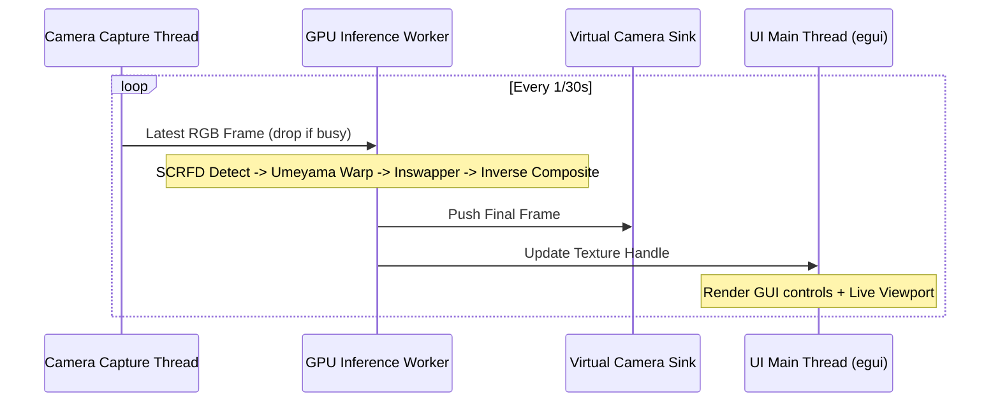

# Research: Real-Time Rust Deepfake Face Swap & Virtual Camera Pipeline

This research document investigates the model selection, mathematical alignment pipeline, inference runtimes, camera I/O, and GUI architecture required to build a high-performance (30+ FPS), low-latency live deepfake face swap application in Rust on Windows.

---

## 1. Executive Summary & Recommended Architecture

To achieve sustained real-time performance (30–60 FPS at 720p/1080p) on consumer GPUs without noticeable video lag, the application should employ an asynchronous multi-threaded pipeline around **ONNX Runtime** and lightweight model architectures.

```
 [Webcam Input] (nokhwa / MSMF)
       │
       ▼ (Raw frame: e.g. 1280x720)
 [Face Detection & 5-pt Landmarks] (SCRFD ONNX ~3ms)
       │
       ▼ (5 landmarks: eyes, nose, mouth corners)
 [2D Similarity Transform] (Umeyama Algorithm -> 128x128 crop)
       │
       ├───► [Target Embedding] (ArcFace 512-d, computed ONCE on upload)
       ▼
 [Face Swap Inference] (inswapper_128.onnx ~10-15ms via DirectML/CUDA)
       │
       ▼ (Swapped 128x128 face tensor)
 [Inverse Affine Composite & Blending] (Feathered / Elliptical Alpha Mask)
       │
       ├───────────────────────────────┐
       ▼                               ▼
 [Virtual Camera Sink]        [egui / eframe Preview]
 (virtualcam crate)           (GPU Texture Display)
```

---

## 2. Model Selection & Pipeline Breakdown

### 2.1 Face Swapper: `inswapper_128.onnx` (InsightFace)
- **Primary Source**: InsightFace Research & Models ([InsightFace ModelScope](https://modelscope.cn/models/damo/cv_manual_face-swap_insightface), [InsightFace GitHub](https://github.com/deepinsight/insightface))
- **Model Size**: ~529 MB ONNX format.
- **Input 1 (`target`)**: `[1, 3, 128, 128]` RGB float tensor normalized to `[0.0, 1.0]`. The aligned target face crop.
- **Input 2 (`source`)**: `[1, 512]` float tensor. The ArcFace identity embedding vector of the source/target face.
- **Output**: `[1, 3, 128, 128]` RGB float tensor. Swapped face in normalized coordinates.
- **Inference Latency**:
  - NVIDIA RTX 3060 / 4060: ~10–14ms (DirectML / CUDA).
  - Apple Silicon M-series: ~12–18ms (CoreML).
  - Modern Intel/AMD iGPU: ~25–35ms (DirectML).
- **Comparison with Alternatives**:
  - **SimSwap (224 / 512)**: Higher native resolution, but model latency is 45–90ms per frame. Unviable for live 30+ FPS feeds on mainstream GPUs without multi-GPU or extreme quantization.
  - **Ghost (GHOST)**: Inconsistent ONNX export support; higher memory footprint and slower warmup times.
  - **Why `inswapper_128` wins**: It performs the identity replacement strictly on the normalized face crop ($128 \times 128$), leaving background and hair untouched. When composited back via inverse affine transformation, the resulting video retains the camera's native 720p/1080p resolution while keeping inference overhead minimal.

### 2.2 Face Detector & Landmark Extractor: `SCRFD`
- **Primary Source**: *SCRFD: Sample and Computation Redistribution for Efficient Face Detection* (Guo et al., 2021; [ArXiv:2105.04714](https://arxiv.org/abs/2105.04714))
- **Recommended Variant**: `scrfd_2.5g_bnkps.onnx` (or lightweight `scrfd_500m_bnkps.onnx`).
- **Function**: Simultaneously outputs face bounding boxes, detection confidences, and **5 facial keypoints** (left eye, right eye, nose tip, left mouth corner, right mouth corner).
- **Latency**: ~2–4ms on GPU at $640 \times 640$ input scale.
- **Advantage**: Bypasses the need for a separate landmark detection network (e.g. 2d106det / 68-point dlib), saving an entire inference pass per frame.

### 2.3 Identity Feature Extractor: `ArcFace`
- **Primary Source**: *ArcFace: Additive Angular Margin Loss for Deep Face Recognition* (Deng et al., CVPR 2019; [ArXiv:1801.07698](https://arxiv.org/abs/1801.07698))
- **Model**: `w600k_r50.onnx` (ResNet-50 backbone) or `glintr100.onnx`.
- **Input**: `[1, 3, 112, 112]` aligned face.
- **Output**: `[1, 512]` L2-normalized embedding.
- **Key Pipeline Optimization**: **Run once on user image upload**. The target identity vector is static during the session. Calculating the 512-dim embedding once and caching it in memory reduces per-frame inference cost for identity extraction to **0ms**.

### 2.4 Face Restoration (Enhancers): Recommendation
- **Models**: `GFPGANv1.4` or `CodeFormer`.
- **Evaluation**: While face restoration models enhance resolution from 128px up to 512px, their inference time is 40–120ms per face.
- **Recommendation**: For a real-time 30+ FPS interactive camera stream, **do not run GFPGAN/CodeFormer on every frame**. Instead, use smooth cubic/bilinear interpolation with edge feathering during paste-back. Keep face enhancement as an optional post-processing toggle for high-end GPUs only.

---

## 3. Mathematical Alignment & Paste-Back Pipeline

InsightFace models depend on standard 5-point alignment coordinates.

### 3.1 Standard 5-Point Destination Template ($128 \times 128$)
- Left eye: `(38.2946, 51.6963)`
- Right eye: `(73.5318, 51.5014)`
- Nose tip: `(56.0252, 71.7366)`
- Left mouth corner: `(41.5493, 92.3655)`
- Right mouth corner: `(70.7299, 104.0304)`

### 3.2 Umeyama 2D Similarity Transform
- **Primary Source**: *Least-Squares Estimation of Transformation Parameters Between Two Point Sets* (Shinji Umeyama, IEEE TPAMI 1991; [IEEE Xplore](https://ieeexplore.ieee.org/document/88573))
- Calculates a $2 \times 3$ affine transformation matrix $M$ encompassing uniform scale $s$, rotation $R$, and translation $t$ minimizing mean squared error between detected keypoints and the template.
- Implemented in Rust in ~30 lines using SVD (via `nalgebra` or pure matrix operations).

### 3.3 Crop, Inference, Inverse Warp & Blending
1. **Warp target crop**: Apply $M$ to current camera frame to extract a $128 \times 128 \times 3$ image.
2. **Inference**: Pass crop + 512-d embedding to `inswapper_128`.
3. **Inverse Affine ($M^{-1}$)**: Invert the $2 \times 3$ affine matrix.
4. **Feathered Mask Composite**:
   - Construct a static $128 \times 128$ elliptical/Gaussian alpha mask with feathered boundaries (sigma ~ 10-15px).
   - Warp the swapped face and the mask back to the original frame canvas using $M^{-1}$.
   - Blend: $\text{Frame}_{\text{out}} = \text{Frame}_{\text{orig}} \cdot (1 - \text{Mask}_{\text{inv}}) + \text{Face}_{\text{swapped}} \cdot \text{Mask}_{\text{inv}}$.

---

## 4. Rust Ecosystem & Technology Stack

### 4.1 Inference Runtime: `ort`
- **Primary Source**: [pyke.io / ort crate](https://crates.io/crates/ort) (v2.0)
- Rust bindings for Microsoft ONNX Runtime.
- **Execution Providers**:
  - **DirectML (`ort/directml`)**: Best for Windows deployment. Native DirectX 12 hardware acceleration across NVIDIA, AMD, and Intel GPUs. Requires no external CUDA toolkit installation by the end user.
  - **CUDA / TensorRT (`ort/cuda`, `ort/tensorrt`)**: Optional feature for maximum throughput on NVIDIA hardware.
- Memory management: Pre-allocate session input/output tensors (`ort::value::Tensor`) to prevent per-frame heap allocations.

### 4.2 Camera Input: `nokhwa`
- **Primary Source**: [crates.io/crates/nokhwa](https://crates.io/crates/nokhwa) (v0.10)
- Feature: `input-native` (resolves to Microsoft Media Foundation / MSMF on Windows).
- Provides camera device enumeration (friendly names, IDs), resolution/framerate negotiation (e.g. 1280x720 @ 30/60 FPS), and non-blocking frame polling into RGB buffers.

### 4.3 Virtual Camera Output: `virtualcam`
- **Primary Source**: [crates.io/crates/virtualcam](https://crates.io/crates/virtualcam)
- Supports:
  - **OBS Virtual Camera transport** (`obs` feature): Streams frames directly to the OBS Virtual Camera driver installed on Windows 10/11. Recognized immediately by Discord, Zoom, Microsoft Teams, and Google Meet.
  - **Windows 11 Media Foundation VCam** (`media-foundation` feature): Native Windows 11 virtual camera API without external drivers.
  - **Linux fallback**: `v4l2loopback` support.

### 4.4 GUI Framework: `eframe` / `egui`
- **Primary Source**: [crates.io/crates/egui](https://crates.io/crates/egui) & [crates.io/crates/eframe](https://crates.io/crates/eframe)
- Immediate-mode Rust GUI framework.
- Minimal CPU overhead (~0.5ms per frame); compiles to native DirectX/WGPU/OpenGL.
- Features needed:
  - Dropdown `egui::ComboBox` to select from enumerated camera devices.
  - Native file picker dialog via [`rfd`](https://crates.io/crates/rfd) to load target face photos (PNG, JPG, WebP).
  - Target face preview & live camera output viewport rendered as `egui::TextureHandle`.
  - Toggle buttons for virtual camera streaming, FPS metrics, and confidence thresholds.

---

## 5. Threading & Concurrency Architecture

To guarantee smooth 30+ FPS without camera stutter or GUI freezing, tasks must run across isolated threads communicating via bounded lock-free channels (`crossbeam-channel` or `triple-buffer`):



1. **Camera Thread**: Continuously captures from MSMF and writes to a `latest_frame` buffer. If the inference worker is currently busy, older frames are dropped so processing is always done on the most recent frame (zero latency lag).
2. **GPU Inference Worker**: Owns the ONNX runtime sessions (`SCRFD` and `Inswapper`). Performs alignment, inference, and blending.
3. **Virtual Camera Sink**: Feeds the composite buffer to the virtual camera device.
4. **UI Thread**: Runs the `eframe` render loop at display refresh rate, querying device states and presenting the live texture handle.

---

## 6. Primary Source References

1. **InsightFace Project**:
   - Repository: <https://github.com/deepinsight/insightface>
   - Models: `inswapper_128.onnx`, `scrfd_2.5g_bnkps.onnx`, `w600k_r50.onnx`
2. **ArcFace (CVPR 2019)**:
   - Paper: Deng, J., Guo, J., Xue, N., & Zafeiriou, S. *ArcFace: Additive Angular Margin Loss for Deep Face Recognition*. [arXiv:1801.07698](https://arxiv.org/abs/1801.07698).
3. **SCRFD (2021)**:
   - Paper: Guo, J., Deng, J., Lattas, A., & Zafeiriou, S. *Sample and Computation Redistribution for Efficient Face Detection*. [arXiv:2105.04714](https://arxiv.org/abs/2105.04714).
4. **Umeyama Similarity Transform (1991)**:
   - Paper: Umeyama, S. *Least-squares estimation of transformation parameters between two point sets*. IEEE Transactions on Pattern Analysis and Machine Intelligence, 13(4), 376-380. [DOI: 10.1109/34.88573](https://doi.org/10.1109/34.88573).
5. **Microsoft ONNX Runtime & `ort` Rust Crate**:
   - `ort` documentation: <https://docs.rs/ort>
   - ONNX Runtime Execution Providers: <https://onnxruntime.ai/docs/execution-providers/>
6. **Hardware Video & Camera Crates**:
   - `nokhwa`: <https://crates.io/crates/nokhwa>
   - `virtualcam`: <https://crates.io/crates/virtualcam>
   - `eframe` / `egui`: <https://crates.io/crates/egui>
   - `rfd`: <https://crates.io/crates/rfd>
